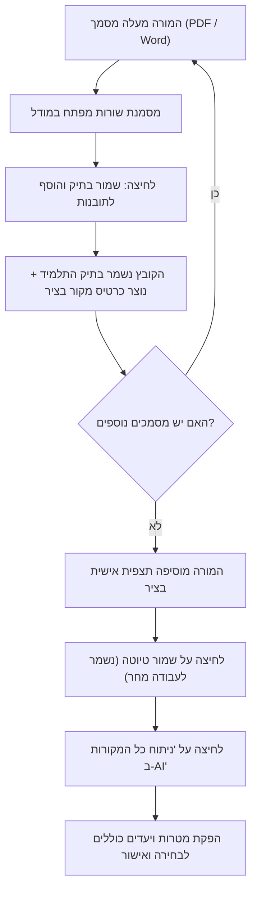

# מפרט אפיון וארכיטקטורה: ציר תובנות פדגוגי ומודל קליטת מסמכים (TALA)

> **סטטוס:** מוצע לסקירה ואישור (Review & Approval by Moti & Zivit)  
> **גרסה:** 1.0  
> **עקרון מנחה:** KISS (Keep It Simple, Stupid) • אפס עומס קוגניטיבי למורה • אבטחת מידע ופרטיות

---

## 1. תקציר מנהלים (Executive Summary)

בעקבות משוב מהשטח, מורות וגננות עובדות בתהליך הדרגתי ורב-יומי:
1. **ביום א׳**: מעלות מסמך ראשון (למשל, סיכום ועדת אפיון וזכאות) ומסמנות מתוכו עיקרים.
2. **ביום ב׳**: מעלות מסמך שני (למשל, תל״א שנה קודמת או דוח ריפוי בעיסוק).
3. **ביום ג׳**: מוסיפות את התצפית האישית והדגשים העדכניים שלהן.
4. **ורק אז**: מפעילות ניתוח AI כולל שגוזר מטרות ויעדים פדגוגיים מכלל המקורות יחד.

כדי לתמוך בתהליך זה בצורה הפשוטה ביותר וללא תפריטים מורכבים:
- **מודל קליטת המסמך מפשט**: מוסר ממנו כפתור ה-AI; תפקידו היחיד הוא שמירת הקובץ בתיק וחילוץ השורות הנבחרות.
- **אזור "תיאור חופשי של הילד/ה" משודרג ל"ציר תובנות פדגוגי"**: מעוצב כבועות/כרטיסי הודעות (בדומה לצ׳אט), המציגות בבירור מה הגיע מאיזה מסמך, מתי, ומהן תצפיות המורה, עם אפשרות מחיקה מהירה (`🗑️`) וכפתור שמירה מקומי.

---

## 2. מסע המשתמשת (User Journey)



---

## 3. רכיבי המערכת והשינויים הנדרשים

### א. מודל קליטת מסמך (`DiagnosticIntakeModal.tsx`)
1. **פישוט ממשק המודל**:
   - הסרת כפתור `נתח ב-AI וגזור תוכנית` מהמודל.
   - הסרת שדה ההזנה המיותר "תוספת הערות ודגשים" מתוך המודל (ההערות נכתבות מעתה ישירות בציר הראשי).
2. **כפתורי הפעולה בתחתית המודל**:
   - **ביטול**: סגירת המודל ללא שינוי.
   - **שמור בתיק והוסף לתובנות** (Primary CTA):
     - מעלה ושומר את הקובץ המקורי ל-Storage בתיק התלמיד.
     - מחלץ את השורות המסומנות ויוצר אובייקט `ObservationSnippet`.
     - מעביר את ה-snippet למסך הראשי וסוגר את המודל.

### ב. ציר התובנות בטופס הראשי (`EcologicalWorkPlanForm.tsx`)
החלפת שדה ה-Textarea הרגיל ברכיב ציר ויזואלי:
1. **כרטיסי תובנה (Snippet Cards)**:
   - **כרטיס מסמך חיצוני**: רקע כחלחל/סגלגל בהיר, אייקון `📄`, שם המסמך, שעת העלאה, ציטוט השורות שנבחרו, וכפתור `🗑️` למחיקה מהירה.
   - **כרטיס תצפית מורה**: רקע סגול בהיר, אייקון `✍️`, שם המורה, תוכן התצפית, וכפתור `🗑️`.
2. **שדה הזנה מהיר להוספת תצפית אישית**:
   - שורת טקסט + כפתור `[ הוסף לתובנות ➕ ]`.
3. **סרגל פעולות עליון בכרטיס**:
   - מונה מקורות פעיל (למשל: "3 מקורות פעילים").
   - כפתור `📎 העלאת מסמך נוסף` (פותח את המודל).
   - כפתור `💾 שמור טיוטה` (שומר מיידית ל-Firestore עם חיווי ירוק קופץ `✓ נשמר`).
4. **סרגל הפעלה תחתון (AI Trigger)**:
   - כפתור בולט: `[ ✨ ניתוח כל המקורות ב-AI ]`.
   - מאגד את כל התובנות הפעילות לפרומפט יחיד ומייצר מטרות ויעדים.

---

## 4. מודל הנתונים (Data Schema)

הרחבת אובייקט הנתונים של התלמיד/ה (`DiagnosticIntakeStudentData` / `student`):

```typescript
export interface PedagogicalSnippet {
  id: string;                      // מזהה ייחודי
  sourceType: 'document' | 'teacher_note'; // סוג מקור
  sourceTitle: string;             // למשל: "סיכום ועדת אפיון תשפ״ו.docx"
  documentId?: string;             // קישור לקובץ ב-dossier (אם מקורו במסמך)
  content: string;                 // הטקסט הנבחר / תצפית המורה
  authorName?: string;             // שם המורה
  createdAt: string;               // ISO Timestamp
}
```

שדה חדש בטופס התלמיד:
```typescript
pedagogicalSnippets?: PedagogicalSnippet[];
```

> **תאימות לאחור (Backward Compatibility):**
> עבור תוכניות קיימות שבהן קיים `teacherFreeText` כמחרוזת טקסט רגילה: בטעינה ראשונה, אם קיים טקסט ואין snippets, הוא יוצג אוטומטית ככרטיס מסוג `teacher_note`.

---

## 5. אבטחה, פרטיות וביצועים (5 Engineering Pillars)

1. **KISS**: שימוש ברכיבי כרטיס פשוטים, ללא עורכי Rich-Text כבדים ששוברים סמן ו-RTL.
2. **אבטחה ופרטיות (Zero Trust & PII)**:
   - בדיקת Magic Bytes וסריקת סקריפטים נשמרות בהעלאת כל קובץ.
   - הערת פרטיות ברורה: איסור הזנת ת״ז ופרטים מזהים ישירים.
3. **ביצועים**:
   - שמירה מקומית מהירה ועדכון State מידי ללא Re-render של כל הטופס.
4. **נראות מקצועית**:
   - כפתורי `32x32px` אחידים.
   - עיצוב בועות עגולות נקי בסגנון הצ׳אט הקיים במערכת (בהתאם לצילום המסך שאושר).

---

## 6. תוכנית בדיקות (Test Plan)

- **יחידה (Unit Tests)**:
  1. וידוא שמודל קליטת מסמך מעביר שורות מסומנות כ-snippet ללא הפעלת AI.
  2. וידוא הוספה ומחיקה של snippet מהציר.
  3. וידוא פונקציית האיגוד (Aggregation) שבונה את פרומפט ה-AI מכלל הכרטיסים.
- **רגרסיה (Regression)**:
  - טעינת תוכנית ישנה עם `teacherFreeText` מוודאת המרה תקינה לכרטיס ללא איבוד מידע.
