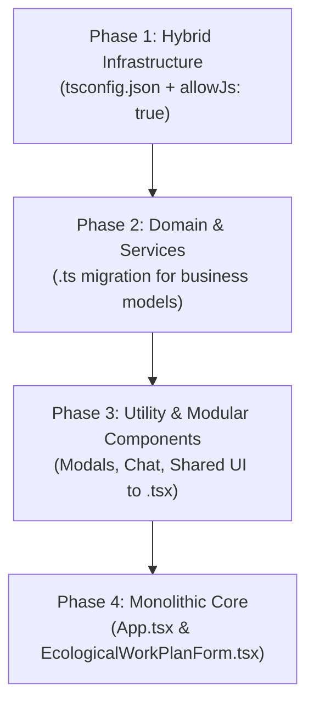

# TALA TypeScript Migration Architecture & Execution Plan

> **Status:** Strategic Roadmap (Future Execution – Phased Implementation)  
> **Target Version:** 2.5.0+  
> **Author:** Antigravity / TALA Core Engineering  

---

## 1. Executive Summary & Problem Definition

In production incident SEV-1 (November 2026), an undeclared identifier (`isDemoStudent`) in `EcologicalWorkPlanForm.jsx` passed through `npm run build` and unit tests undetected, throwing a client-side `ReferenceError` during AI report reverse-engineering. 

While the immediate gap has been resolved via:
1. **ESLint Gate (`no-undef: error`)** in `npm run build`.
2. **Client-side error telemetry** reporting `AI_CLIENT_PROCESSING_ERROR` directly to the Admin Dashboard.
3. **Runtime component execution tests** replacing string-inspection tests.

The permanent architectural resolution is migrating the TALA codebase from JavaScript (JSX) to **TypeScript (TSX)**. This document outlines the zero-regression, progressive roadmap to complete this transition without halting feature delivery.

---

## 2. Codebase Topology & Migration Sizing

The current frontend codebase comprises:
- **Total Modules:** 166 files (`.js`, `.jsx`)
- **Total Volume:** ~30,000+ lines of code
- **Largest Component:** `EcologicalWorkPlanForm.jsx` (~7,400 lines)

### Structural Layers:
```
src/
├── domain/       # Pure business logic, schemas, sanitization (~15 files)
├── services/     # Firebase, AI proxy, telemetry, storage (~18 files)
├── components/   # UI widgets, modal dialogs, drawers (~45 files)
├── __tests__/    # Vitest suites (~80 files)
└── App.jsx       # Root orchestration component (~4,300 lines)
```

---

## 3. Phased Migration Strategy (Zero Big-Bang)

To protect production and avoid regressions, migration MUST proceed in 4 strictly isolated phases:



### Phase 1: Hybrid Infrastructure (Preparation)
- **Goal:** Enable TypeScript compiler alongside Vite without breaking any existing JS/JSX.
- **Actions:**
  - Create `tsconfig.json` with `allowJs: true`, `checkJs: false`, `noEmit: true`, `jsx: "react-jsx"`.
  - Add `npm run type-check: "tsc --noEmit"` to deployment gates.
  - Retain ESLint `no-undef` as a secondary safety harness.

### Phase 2: Domain Models & Core Services (High ROI, Low Risk)
- **Scope:** `src/domain/` and `src/services/`.
- **Primary Interfaces to Formalize:**
  1. `StudentProfile` & `EcologicalGoal` (goalBank, stages, evaluations).
  2. `TelemetryEventEnvelope` & `HealthEventPayload`.
  3. `AiProxyPayload` & `AiGenerationResult`.
  4. `UserAccount` & `TenantScope` (Matya isolation).
- **Execution:** Convert files to `.ts` one by one, ensuring zero `@ts-ignore` without human-approved justification.

### Phase 3: Modular UI Components & Dialogs
- **Scope:** `src/components/modals/`, `src/components/chat/`, `src/components/admin/`.
- **Execution:**
  - Convert self-contained leaf components to `.tsx`.
  - Type component `Props` explicitly (`interface Props { ... }`).
  - Standardize event callbacks and modal closures (`onClose: () => void`).

### Phase 4: Core Monoliths (`App.tsx` & `EcologicalWorkPlanForm.tsx`)
- **Prerequisite:** Deconstruct large components into domain-driven sub-hooks before converting.
- **Sub-tasks:**
  1. Extract form state hooks (`useWorkPlanState`, `useAiReverseEngineer`).
  2. Extract print and export builders to standalone typed modules.
  3. Convert residual container components to `.tsx`.

---

## 4. Strict Engineering Guardrails

During migration, all PRs must adhere to these non-negotiable rules:
1. **Zero `any` in New Types:** Use strict unions, generics, or `unknown` with type guards.
2. **PR Size Limit:** Maximum 3-5 converted files per PR to allow thorough code review and regression testing.
3. **Mandatory Dual Gate:** Every PR must pass both `npm run lint` and `npm run type-check` before squash merge.
4. **Preserve Hebrew RTL & Visual Contracts:** Automated screenshot / DOM regression checks must ensure zero UI shifts.
