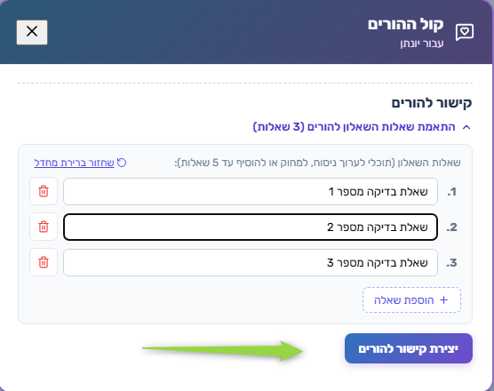
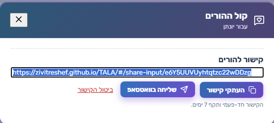
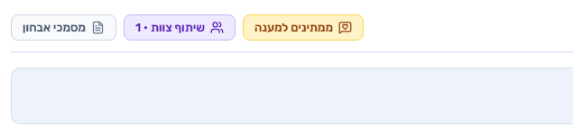
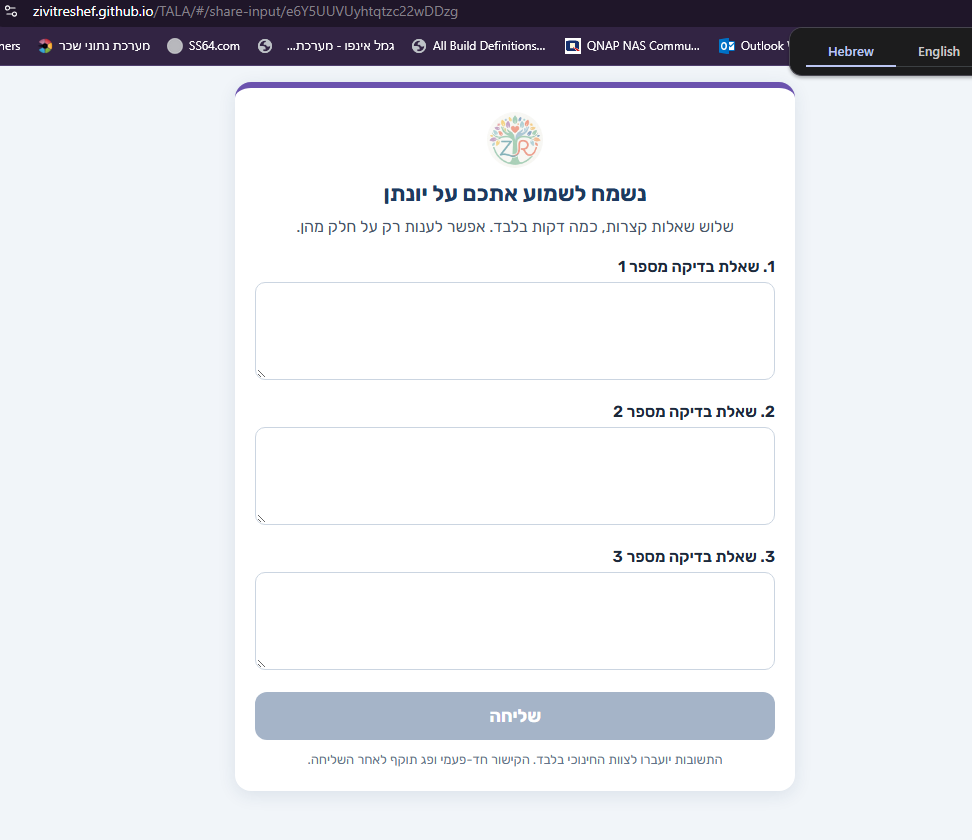
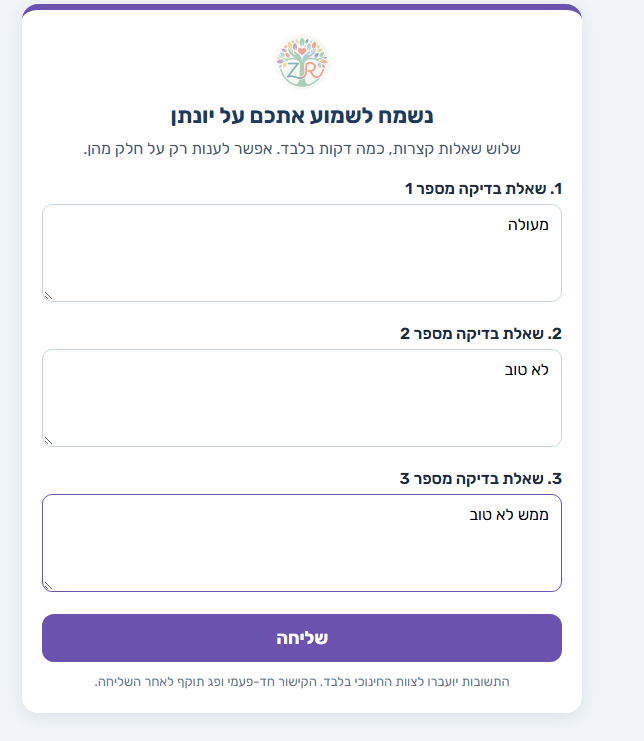
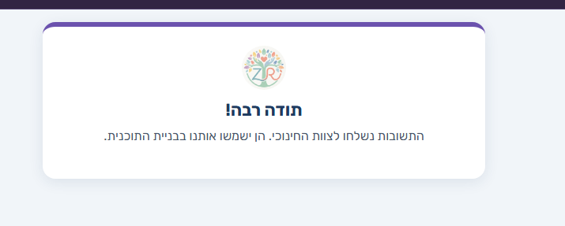
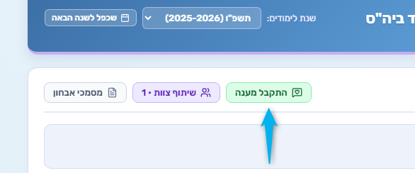
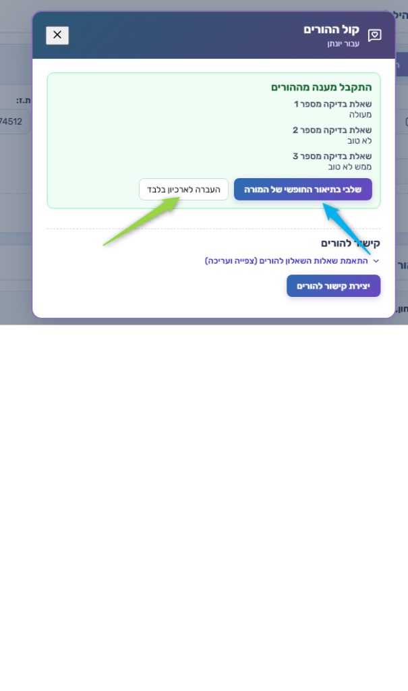

# זרימת «קול ההורים»

תיעוד קצר של תהליך שליחת שאלון להורים וקבלת מענה, לפי צילומי מסך מסודרים לפי חותמת זמן (05.11.2026).

**דוגמה:** תלמיד — יונתן · שנת לימודים תשפ״ו (2025–2026)

---

## סקירה

| שלב | שעה | מי | מה קורה |
|-----|-----|----|---------|
| 1 | 15:44:31 | צוות | התאמת שאלות ויצירת קישור |
| 2 | 15:44:47 | צוות | העתקה / שליחה בוואטסאפ |
| 3 | 15:45:05 | מערכת | סטטוס «ממתינים למענה» |
| 4 | 15:45:31 | הורה | פתיחת השאלון |
| 5 | 15:45:49 | הורה | מילוי תשובות |
| 6 | 15:45:57 | הורה | אישור שליחה |
| 7 | 15:46:06 | מערכת | סטטוס «התקבל מענה» |
| 8 | 15:46:18 | צוות | צפייה במענה והחלטה: לתאר / לארכב |

---

## שלב 1 — התאמת שאלות ויצירת קישור

**חותמת זמן:** `15:44:31`

במסך **קול ההורים** (עבור יונתן) נפתח אזור **קישור להורים**.

- עריכת ניסוח השאלות, מחיקה או הוספה (עד 5)
- אפשרות **שחזור ברירת מחדל**
- לחיצה על **יצירת קישור להורים**



---

## שלב 2 — שיתוף הקישור

**חותמת זמן:** `15:44:47`

נוצר קישור חד־פעמי (תקף ל־7 ימים).

פעולות זמינות:
- **העתק קישור**
- **שליחה בוואטסאפ**
- **ביטול הקישור**



---

## שלב 3 — ממתינים למענה

**חותמת זמן:** `15:45:05`

בכרטיס התלמיד מוצג כפתור סטטוס **ממתינים למענה** (צהוב), לצד שיתוף צוות ומסמכי אבחון.



---

## שלב 4 — ההורה פותח את השאלון

**חותמת זמן:** `15:45:31`

ההורה נכנס לקישור (מסך `share-input`).

- כותרת: «נשמח לשמוע אתכם על יונתן»
- שלוש שאלות קצרות; אפשר לענות רק על חלק
- כפתור **שליחה**
- הבהרה: התשובות לצוות החינוכי בלבד; הקישור חד־פעמי ופוג לאחר שליחה



---

## שלב 5 — מילוי תשובות

**חותמת זמן:** `15:45:49`

ההורה ממלא את השדות (בדוגמה: מעולה / לא טוב / ממש לא טוב) ולוחץ **שליחה**.



---

## שלב 6 — אישור להורה

**חותמת זמן:** `15:45:57`

מסך תודה: התשובות נשלחו לצוות החינוכי וישמשו בבניית התוכנית.



---

## שלב 7 — התקבל מענה (צד צוות)

**חותמת זמן:** `15:46:06`

בכרטיס התלמיד הסטטוס מתחלף ל־**התקבל מענה** (ירוק).



---

## שלב 8 — צפייה במענה והחלטה

**חותמת זמן:** `15:46:18`

במסך **קול ההורים** מוצג המענה מההורים.

שתי אפשרויות:
1. **שלבי בתיאור החופשי של המורה** — שילוב המענה בתיאור
2. **העברה לארכיון בלבד** — שמירה בלי שילוב בתיאור

ניתן גם ליצור קישור חדש להורים בהמשך.



---

## סיכום קצר

```
צוות: התאמת שאלות → יצירת קישור → שיתוף
        ↓
מערכת: ממתינים למענה
        ↓
הורה: פתיחה → מילוי → שליחה → תודה
        ↓
מערכת: התקבל מענה
        ↓
צוות: צפייה → שילוב בתיאור / ארכיון
```

**כללי קישור:** חד־פעמי · תקף ל־7 ימים · פג תוקף לאחר שליחה.
